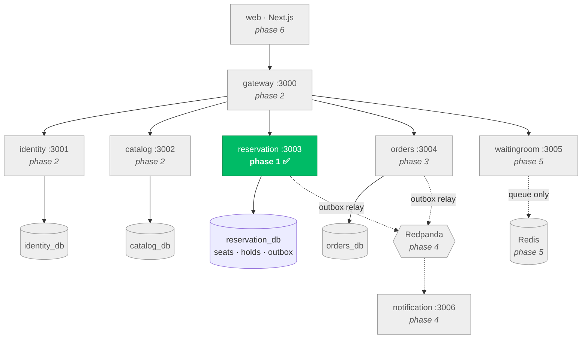

# Distributed Event Ticketing Platform

A production-shaped event ticketing system built as Node.js microservices on PostgreSQL and Kafka.
It sells seats for events under one defining constraint: **a seat must never be sold twice** — not
under a thousand simultaneous buyers, not when a service crashes, not when Redis is down, and not
when a payment settles after the buyer's hold has already expired.

> **Build status: Phase 1 of 8 complete and verified.** This README grows one phase at a time, and
> every number in it is copied from a real command's output. Sections belonging to unbuilt phases
> say so rather than describing something that does not exist yet.
> Progress: [`docs/IMPLEMENTATION_STATUS.md`](docs/IMPLEMENTATION_STATUS.md).

---

## 1. Proof

The proof section comes before the setup instructions on purpose. Claims about correctness are
cheap; this is the evidence.

### 1.1 It does not oversell — 1,000 concurrent requests, 100 seats

1,000 genuinely parallel HTTP requests hit a running service backed by a real PostgreSQL 16
(Testcontainers). Ten contenders per seat, so the arithmetic is exact rather than probabilistic:
every seat is contested, and exactly one contender per seat can win.

```
$ pnpm vitest run --project integration oversell

[testkit] integration infrastructure: real PostgreSQL via testcontainers

──────── OVERSELL PROOF ────────
requests fired      : 1000 (real parallel HTTP)
seats available     : 100
status counts       : {"201":100,"409":900}
client latency (ms) : p50=140.2 p95=200.9 p99=202.3 max=202.8
kernel connect retries: 0 (macOS somaxconn=128; never-sent connections only)

peak concurrent allocations in-flight: 128
oversell_total      : 0  ✅

GA status counts    : {"201":100,"409":900}

 ✓ |integration| apps/reservation/test/integration/oversell.spec.ts (2 tests) 455ms

 Test Files  1 passed (1)
      Tests  2 passed (2)
```

**Exactly 100 × `201`, exactly 900 × `409`, zero oversells** — on both the reserved-seating path
and the general-admission (`FOR UPDATE SKIP LOCKED`) path.

After the run, the assertions continue in SQL against the real database: exactly 100 seats `held`,
zero `sold`, exactly one hold per seat, no seat under two live holds, exactly 100 `SeatHeld` rows
in the outbox, and `oversell_total` reading `0` on `/metrics`.

#### Why `peak concurrent allocations in-flight` is in that output

Counting client sockets does not prove that transactions collided — the kernel is free to
serialize them, and a test that only counts sockets can pass without ever creating contention.
So the service itself reports the peak number of allocation handlers alive at the same instant.
**128 concurrent allocations were in flight**, which is what makes the 100/900 split meaningful.

(macOS caps the listen backlog at `kern.ipc.somaxconn` = 128 and will not let it be raised without
root, so the harness issues all 1,000 requests at once over a 128-connection pool rather than
opening a socket per request. Opening 1,000 sockets overflows the kernel accept queue, and the
resulting RSTs measure macOS, not seat allocation.)

### 1.2 The rest of the proofs

| Proof | Phase | Status |
|---|---|---|
| 1,000 concurrent requests / 100 seats | 1 | ✅ verified — above |
| Idempotent replay produces one hold | 1 | ✅ verified |
| Expired hold never blocks a buyer | 1 | ✅ verified |
| Partial baskets never commit | 1 | ✅ verified |
| Finalize-after-expiry returns `410` | 1 | ✅ verified |
| Refresh-token reuse detection | 2 | not built yet |
| Webhook replay ×50 → one ticket | 3 | not built yet |
| Payment-after-expiry compensation | 3 | not built yet |
| Kafka broker failure and recovery | 4 | not built yet |
| Redis failure → zero oversells | 5 | not built yet |
| k6 load test, real p50/p95/p99 | 7 | not built yet |
| `requestId` traced end to end | 7 | not built yet |

Full Phase 1 suite: **32 tests passing**, run four consecutive times with identical results.

```
 Test Files  7 passed (7)
      Tests  32 passed (32)
```

---

## 2. The seat allocation algorithm

One conditional `UPDATE`. This is the whole correctness argument, and it is deliberately the least
abstracted code in the repository — [`apps/reservation/src/allocation.ts`](apps/reservation/src/allocation.ts).

```sql
UPDATE seats
SET status = 'held',
    hold_id = $1,
    held_until = now() + ($2 || ' seconds')::interval,
    version = version + 1,
    updated_at = now()
WHERE seat_id = ANY($3)
  AND (
    status = 'available'
    OR (status = 'held' AND held_until < now())
  )
RETURNING seat_id;
```

Two ideas carry all the weight.

**The lock is the data.** There is no Redis lock, no Redlock, no lease, no fencing token. The
condition is evaluated and the mutation performed as *one* operation against committed state, under
a row lock Postgres takes automatically. Zero rows returned means the race was lost. There is no
window between checking and acting in which a paused process can act on a stale belief.

**Expiry is a predicate.** `held_until < now()` lives in the `WHERE` clause, so a hold is expired
the instant the clock passes it, whether or not anything has "processed" the expiry. Nothing on the
correctness path runs on a schedule, so nothing on the correctness path can fail to run. A janitor
job tidies stale rows every 60 seconds for clean reads, and **it is safe for it to never run** —
every test in this repository runs with it disabled.

If the `UPDATE` returns fewer rows than requested, the whole transaction rolls back and the client
receives `409` naming the seats it lost. Partial baskets are not allowed: a buyer who asked for four
seats together does not want two.

### Why not Redlock

A distributed lock puts a gap between *holding the lock* and *acting on the data*. A process can
acquire the lock, get paused by a GC pause or CPU throttle or network partition, have its lease
expire, then resume and write while still believing it holds the lock — the classic fencing-token
problem. Mitigating it properly requires the storage layer to reject stale writes, which means the
storage layer needed to participate in the locking all along.

Making the lock *be* the data removes the gap entirely. No lease to expire, no clock assumption, no
split-brain. The check and the mutation are the same operation.

Full reasoning in [ADR-002](DECISIONS.md).

---

## 3. Architecture

Six services, database per service, no service reading another's tables. Phase 1 has built the one
that decides who gets a seat.



`catalog` and `reservation` are separate because seatmap reads outnumber seat writes by roughly
three orders of magnitude and have opposite consistency requirements: a seatmap may be served from
a 5-second-stale cache, an allocation may not be stale by a millisecond ([ADR-006](DECISIONS.md)).

---

## 4. Reservation API (Phase 1)

| Method | Route | Purpose |
|---|---|---|
| `POST` | `/reservations` | Acquire a hold. All-or-nothing basket, or `tierId` + `quantity` for general admission. `409` names the lost seats. |
| `DELETE` | `/reservations/:holdId` | Release a hold early |
| `POST` | `/reservations/:holdId/finalize` | Convert a live hold to `sold`; `410 Gone` if the seat was lost |
| `PATCH` | `/holds/:holdId/extend` | Extend a live hold (never an expired one) |
| `GET` | `/availability` | Seats free right now, using the same expiry predicate |
| `GET` | `/metrics` | Prometheus text, including `oversell_total` |
| `GET` | `/healthz`, `/readyz` | Liveness and readiness |

Every mutating route accepts an `Idempotency-Key`. Same key + same body replays the stored response
and creates nothing new; same key + a *different* body returns `422` rather than silently serving a
stale result, because that combination is a client bug that should surface loudly
([ADR-009](DECISIONS.md)).

---

## 5. Quickstart

Requires Node 22+, pnpm, and a Docker daemon for the integration tests.

```bash
pnpm install
pnpm typecheck && pnpm lint && pnpm build
pnpm test                                        # 32 tests, real PostgreSQL
pnpm vitest run --project integration oversell   # the proof, on its own
```

Integration tests start a real PostgreSQL 16 via Testcontainers; each suite gets its own logical
database and the service's real migrations are run against it. Nothing about the infrastructure is
mocked. Where no Docker daemon is reachable the harness falls back to an embedded **real**
PostgreSQL 16 server, so the suite still runs against a genuine database rather than a fake.

`docker compose up` arrives with Phase 7, per the build order in [`PRD.md`](PRD.md) §16.

---

## 6. Documentation

| Document | Contents |
|---|---|
| [`PRD.md`](PRD.md) | Product and technical specification (source of truth) |
| [`DECISIONS.md`](DECISIONS.md) | ADR-001 … ADR-018, with the cost accepted for each |
| [`docs/IMPLEMENTATION_PLAN.md`](docs/IMPLEMENTATION_PLAN.md) | Phase breakdown, invariant matrix, risks |
| [`docs/IMPLEMENTATION_STATUS.md`](docs/IMPLEMENTATION_STATUS.md) | Live phase gates and verification reports |
| [`docs/ENVIRONMENT_AUDIT.md`](docs/ENVIRONMENT_AUDIT.md) | Phase 0 audit and the deviation register |

---

## 7. Invariants

| ID | Invariant | Enforced by | Status |
|---|---|---|---|
| INV-1 | A seat is never `sold` under more than one order | Conditional `UPDATE` + one `order_id` per seat row + `oversell_total` | ✅ proven |
| INV-2 | A seat is never `held` by two holds at once | Conditional `UPDATE`, row locks, all-or-nothing basket | ✅ proven |
| INV-3 | Money is never captured without a `sold` seat | Finalize-then-capture, manual capture | phase 3 |
| INV-4 | A seat is never `sold` without captured payment | Compensation path | phase 3 |
| INV-5 | An expired hold never blocks another buyer | `held_until < now()` predicate, no reaper | ✅ proven |
| INV-6 | Idempotent replay causes no extra side effects | `idempotency_keys` + body hash | ✅ proven (reservation) |
| INV-7 | Correctness never depends on Redis, Kafka or a job | Postgres-only correctness path | ✅ proven for Phase 1 scope |
| INV-8 | No overlapping *sold* occupancies (segmented mode) | GiST `EXCLUDE` constraint | phase 8 |

---

## 8. Known limitations

Carried from [`DECISIONS.md`](DECISIONS.md) and tracked honestly as the build proceeds.

- Phases 2–8 are not built yet; the table in §1.2 is the authoritative list of what is and is not proven.
- Seat writes are single-node. Sharding by `event_id` is the natural next step and is unimplemented.
- The outbox relay (Phase 4) will poll every 500 ms; CDC would be lower latency.
- No distributed tracing — `requestId` propagation is the deliberate substitute ([ADR-015](DECISIONS.md)).
