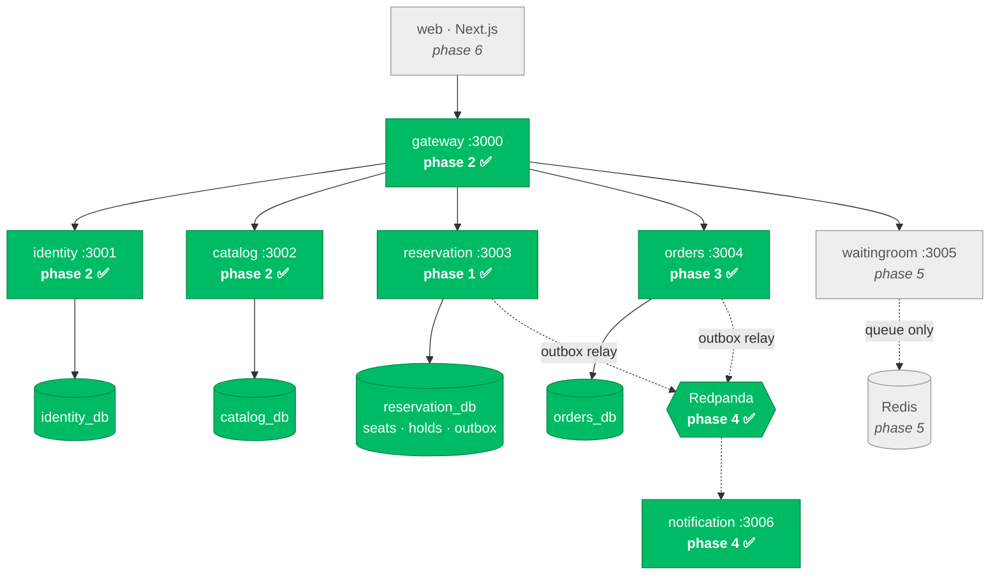

# Distributed Event Ticketing Platform

A production-shaped event ticketing system built as Node.js microservices on PostgreSQL and Kafka.
It sells seats for events under one defining constraint: **a seat must never be sold twice** — not
under a thousand simultaneous buyers, not when a service crashes, not when Redis is down, and not
when a payment settles after the buyer's hold has already expired.

> **Build status: Phases 1–4 of 8 complete and verified.** This README grows one phase at a time, and
> every number in it is copied from a real command's output. Sections belonging to unbuilt phases
> say so rather than describing something that does not exist yet.
> Progress: [`docs/IMPLEMENTATION_STATUS.md`](docs/IMPLEMENTATION_STATUS.md).

---

## 1. Proof

The proof section comes before the setup instructions on purpose. Claims about correctness are
cheap; this is the evidence.

### 1.1 It does not oversell — 1,000 concurrent requests, 100 seats

1,000 genuinely parallel HTTP requests hit a running service backed by a real PostgreSQL 16
(Testcontainers). Ten contenders per seat, so the arithmetic is exact rather than probabilistic:
every seat is contested, and exactly one contender per seat can win.

```
$ pnpm vitest run --project integration oversell

[testkit] integration infrastructure: real PostgreSQL via testcontainers

──────── OVERSELL PROOF ────────
requests fired      : 1000 (real parallel HTTP)
seats available     : 100
status counts       : {"201":100,"409":900}
client latency (ms) : p50=140.2 p95=200.9 p99=202.3 max=202.8
kernel connect retries: 0 (macOS somaxconn=128; never-sent connections only)

peak concurrent allocations in-flight: 128
oversell_total      : 0  ✅

GA status counts    : {"201":100,"409":900}

 ✓ |integration| apps/reservation/test/integration/oversell.spec.ts (2 tests) 455ms

 Test Files  1 passed (1)
      Tests  2 passed (2)
```

**Exactly 100 × `201`, exactly 900 × `409`, zero oversells** — on both the reserved-seating path
and the general-admission (`FOR UPDATE SKIP LOCKED`) path.

After the run, the assertions continue in SQL against the real database: exactly 100 seats `held`,
zero `sold`, exactly one hold per seat, no seat under two live holds, exactly 100 `SeatHeld` rows
in the outbox, and `oversell_total` reading `0` on `/metrics`.

#### Why `peak concurrent allocations in-flight` is in that output

Counting client sockets does not prove that transactions collided — the kernel is free to
serialize them, and a test that only counts sockets can pass without ever creating contention.
So the service itself reports the peak number of allocation handlers alive at the same instant.
**128 concurrent allocations were in flight**, which is what makes the 100/900 split meaningful.

(macOS caps the listen backlog at `kern.ipc.somaxconn` = 128 and will not let it be raised without
root, so the harness issues all 1,000 requests at once over a 128-connection pool rather than
opening a socket per request. Opening 1,000 sockets overflows the kernel accept queue, and the
resulting RSTs measure macOS, not seat allocation.)

### 1.2 The rest of the proofs

| Proof | Phase | Status |
|---|---|---|
| 1,000 concurrent requests / 100 seats | 1 | ✅ verified — above |
| Idempotent replay produces one hold | 1 | ✅ verified |
| Expired hold never blocks a buyer | 1 | ✅ verified |
| Partial baskets never commit | 1 | ✅ verified |
| Finalize-after-expiry returns `410` | 1 | ✅ verified |
| Refresh-token reuse detection | 2 | ✅ verified |
| Webhook replay ×50 → one ticket, one capture | 3 | ✅ verified |
| Payment-after-expiry compensation | 3 | ✅ verified |
| Raw-body webhook signature verification | 3 | ✅ verified |
| Kafka broker killed mid-sale → zero events lost | 4 | ✅ verified |
| Idempotent consumers under redelivery | 4 | ✅ verified |
| `requestId` traced through Kafka into the consumer | 4 | ✅ verified |
| Resource-scoped authorization | 2 | ✅ verified |
| Authenticated booking end to end through the gateway | 2 | ✅ verified |
| 5,000-seat seed | 2 | ✅ verified |
| Redis failure → zero oversells | 5 | not built yet |
| k6 load test, real p50/p95/p99 | 7 | not built yet |
| `requestId` traced end to end | 7 | not built yet |

Full suite through Phase 4: **106 tests passing**, run four consecutive times with identical
results, Phase 1's proof unchanged throughout.

```
 Test Files  18 passed (18)
      Tests  106 passed (106)
```

### 1.3 A stolen refresh token is usable at most once

Rotation is not the security property by itself; detection is. Every refresh consumes the
presented token, so a token presented *after* it was rotated means either a stale client retry or
a stolen copy. Those are indistinguishable, and only one is dangerous, so the safe reading wins:

```
client  → refresh(A) → 200, receives B        (A is now spent)
attacker→ refresh(A) → 401 REFRESH_TOKEN_REUSED
client  → refresh(B) → 401                    ← the whole family died with it
other device (separate family) → refresh → 200 ← blast radius stops at the chain
```

`refresh-reuse.spec.ts` asserts every line of that, including the last one: revoking a user's
*other* sessions would be a denial of service dressed up as security.

### 1.4 A payment that settles after the seat is gone

This is the case that separates the project from a ticketing clone. It **cannot** be eliminated —
that would need a transaction spanning our database and Razorpay's — so it is bounded, detected,
and compensated automatically.

```
buyer holds seat → order created → Razorpay authorizes (NOT captured)
                                          │
                        hold expires; a rival legitimately takes the seat
                                          │
              buyer's callback finally arrives → finalize returns 410 Gone
                                          ↓
                                    compensating
                                          ↓
                   authorization released (nothing was ever captured)
                                          ↓
                                 refunded_seat_lost
                                          ↓
                    OrderCompensated → the user is told, with alternatives
```

`expiry-boundary.spec.ts` asserts the whole thing, and the assertion that matters most is
**`captureCount === 0`**: no money ever moved. That is the entire argument for manual capture
(ADR-007) — with auto-capture this would be a refund pending for five days instead.

Three mechanisms bound the window (ADR-008): refuse to start a payment below 90 seconds of
remaining hold, extend the hold when the payment intent is created, and compensate whatever still
slips through.

### 1.5 Fifty identical webhooks, one ticket

Payment providers redeliver by design. The same `x-razorpay-event-id` delivered 50 times —
**sequentially and concurrently** — produces exactly one ticket and exactly one capture, with no
distributed lock anywhere:

- the event id is claimed by an `INSERT` *before* processing, so the unique constraint picks the
  winner (checking-then-inserting would let two concurrent deliveries both proceed)
- seat finalization is idempotent
- capture reads the payment's state first
- `tickets.seat_id` is `UNIQUE`, the backstop that holds even if every guard above failed

### 1.6 The broker dies and nothing is lost

The Phase 4 gate kills a real Redpanda broker mid-sale:

```
broker killed  →  20 seats still allocated successfully   ← INV-7: Kafka is not on the
               →  25 events pile up in the outbox            correctness path at all
               →  5 relay cycles run, all fail
               →  published_at stays NULL for all 25       ← nothing marked sent that wasn't
broker revived →  all 25 publish, no intervention
               →  processed_events = 25, notifications = 25, duplicate event_ids = 0
```

The seats during the outage are allocated with the *real* `ACQUIRE_HOLD_SQL` imported from the
reservation service, not a copy — the business keeps selling while the message bus is down.

The outage is driven by observed state rather than a 30-second sleep. Asserting "five relay cycles
failed and nothing was marked published" is stronger than waiting and hoping, and PRD §19 rules out
`sleep()` in tests anyway.

---

## 2. The seat allocation algorithm

One conditional `UPDATE`. This is the whole correctness argument, and it is deliberately the least
abstracted code in the repository — [`apps/reservation/src/allocation.ts`](apps/reservation/src/allocation.ts).

```sql
UPDATE seats
SET status = 'held',
    hold_id = $1,
    held_until = now() + ($2 || ' seconds')::interval,
    version = version + 1,
    updated_at = now()
WHERE seat_id = ANY($3)
  AND (
    status = 'available'
    OR (status = 'held' AND held_until < now())
  )
RETURNING seat_id;
```

Two ideas carry all the weight.

**The lock is the data.** There is no Redis lock, no Redlock, no lease, no fencing token. The
condition is evaluated and the mutation performed as *one* operation against committed state, under
a row lock Postgres takes automatically. Zero rows returned means the race was lost. There is no
window between checking and acting in which a paused process can act on a stale belief.

**Expiry is a predicate.** `held_until < now()` lives in the `WHERE` clause, so a hold is expired
the instant the clock passes it, whether or not anything has "processed" the expiry. Nothing on the
correctness path runs on a schedule, so nothing on the correctness path can fail to run. A janitor
job tidies stale rows every 60 seconds for clean reads, and **it is safe for it to never run** —
every test in this repository runs with it disabled.

If the `UPDATE` returns fewer rows than requested, the whole transaction rolls back and the client
receives `409` naming the seats it lost. Partial baskets are not allowed: a buyer who asked for four
seats together does not want two.

### Why not Redlock

A distributed lock puts a gap between *holding the lock* and *acting on the data*. A process can
acquire the lock, get paused by a GC pause or CPU throttle or network partition, have its lease
expire, then resume and write while still believing it holds the lock — the classic fencing-token
problem. Mitigating it properly requires the storage layer to reject stale writes, which means the
storage layer needed to participate in the locking all along.

Making the lock *be* the data removes the gap entirely. No lease to expire, no clock assumption, no
split-brain. The check and the mutation are the same operation.

Full reasoning in [ADR-002](DECISIONS.md).

---

## 3. Architecture

Six services, database per service, no service reading another's tables. Phase 1 has built the one
that decides who gets a seat.



`catalog` and `reservation` are separate because seatmap reads outnumber seat writes by roughly
three orders of magnitude and have opposite consistency requirements: a seatmap may be served from
a 5-second-stale cache, an allocation may not be stale by a millisecond ([ADR-006](DECISIONS.md)).

---

## 4. Reservation API (Phase 1)

| Method | Route | Purpose |
|---|---|---|
| `POST` | `/reservations` | Acquire a hold. All-or-nothing basket, or `tierId` + `quantity` for general admission. `409` names the lost seats. |
| `DELETE` | `/reservations/:holdId` | Release a hold early |
| `POST` | `/reservations/:holdId/finalize` | Convert a live hold to `sold`; `410 Gone` if the seat was lost |
| `PATCH` | `/holds/:holdId/extend` | Extend a live hold (never an expired one) |
| `GET` | `/availability` | Seats free right now, using the same expiry predicate |
| `GET` | `/metrics` | Prometheus text, including `oversell_total` |
| `GET` | `/healthz`, `/readyz` | Liveness and readiness |

| `POST` | `/inventory/:eventId/seats` | Provision seat inventory — only reservation may create seats |

Every mutating route accepts an `Idempotency-Key`. Same key + same body replays the stored response
and creates nothing new; same key + a *different* body returns `422` rather than silently serving a
stale result, because that combination is a client bug that should surface loudly
([ADR-009](DECISIONS.md)).

---

## 5. Payments (Razorpay, manual capture)

```
hold → order → authorization → SEAT FINALIZED → capture → confirmed
```

The order of the last three is the whole design. The seat is taken **before** any money moves, so
the failure mode is "authorization released" and never "customer charged for a seat someone else
owns".

Webhook handling follows PRD §10.3 exactly, and the route **physically cannot see a parsed body**:
it is registered in its own plugin scope whose content-type parser hands over the raw `Buffer`.
Razorpay HMACs the exact bytes it sent, so parsing and re-serialising reorders keys and changes
whitespace, producing a different digest — legitimate traffic then fails verification and looks
like an attack. A unit test asserts that a re-serialised body is rejected.

Seat finalization, hold extension and hold lookup require an internal service token and are not
reachable with a user token. A user who could call finalize directly could take a seat without
paying for it.

---

## 6. Events: the transactional outbox

Writing to Postgres and then publishing to Kafka is a dual write across two systems with no shared
transaction. If the process dies in between, the seat is sold and no notification ever fires — a
silent, permanent inconsistency that no retry can detect, because nothing recorded that the event
was owed.

So the state change and its event commit together, into an `outbox` table, and a relay publishes
from there:

```
BEGIN
  UPDATE seats SET status = 'sold' ...      -- the state change
  INSERT INTO outbox (...)                  -- and the event it owes
COMMIT

-- separately, every 500ms:
BEGIN
  SELECT ... WHERE published_at IS NULL ORDER BY id LIMIT 100 FOR UPDATE SKIP LOCKED
  publish to Kafka                          -- if this throws, the UPDATE never runs
  UPDATE outbox SET published_at = now()
COMMIT
```

A failed publish rolls the cycle back, so nothing is ever marked published that was not sent. The
converse is possible and **accepted**: a publish can succeed and the commit then fail, so a message
is sent twice. That is why delivery is at-least-once and why **every consumer dedupes on
`event_id`**.

`event_id` is derived from `<service>-<outbox row id>` rather than generated per attempt. A random
id would make a retry indistinguishable from a genuinely new event — precisely the distinction
consumers exist to make.

---

## 7. Authentication and authorization

Access tokens are **RS256, 10 minutes**. Refresh tokens are opaque 32-byte values, stored only as
a SHA-256 digest, valid 14 days, and **rotated on every use** with family-wide reuse detection.

The rule that matters is where the decisions are made:

> **The gateway verifies the signature. It never decides what a caller may do, and it forwards no
> identity headers at all.** Every service re-verifies the same bearer token against identity's
> JWKS and makes its own authorization decision.

A service that trusted an upstream `x-user-roles` header would be one misconfigured ingress or one
exposed internal port away from full compromise. Two tests hold that line: one bypasses the gateway
entirely and confirms the service still returns `401`, and one sends forged `x-user-roles` /
`x-user-id` headers alongside a valid attendee token and confirms they buy nothing (`403`).

Permissions are **resource-scoped**, never flat globals — holding `organizer` does not grant
`event:update` on every event:

| Role | Actions | Scope |
|---|---|---|
| `attendee` | `booking:create`, `order:read` | own resources |
| `organizer` | `event:create`, `event:update`, `event:publish` | events they own, or an explicit `organizer:event:<id>` grant |
| `venue_admin` | `venue:*`, `seatmap:write` | venues they administer |
| `scanner` | `ticket:scan` | events assigned to them |
| `platform_admin` | everything | global |

---

## 8. Quickstart

Requires Node 22+, pnpm, and a Docker daemon for the integration tests.

```bash
pnpm install
pnpm typecheck && pnpm lint && pnpm build
pnpm test                                        # 32 tests, real PostgreSQL
pnpm vitest run --project integration oversell   # the proof, on its own
```

Integration tests start a real PostgreSQL 16 via Testcontainers; each suite gets its own logical
database and the service's real migrations are run against it. Nothing about the infrastructure is
mocked. Where no Docker daemon is reachable the harness falls back to an embedded **real**
PostgreSQL 16 server, so the suite still runs against a genuine database rather than a fake.

`docker compose up` arrives with Phase 7, per the build order in [`PRD.md`](PRD.md) §16. Once the
services are running, `pnpm seed` creates a demo organizer, a venue, and an on-sale event with
**5,000 seats**, entirely through the public API — a seed script holding credentials for three
databases would be the first crack in database-per-service. It is safe to re-run.

---

## 9. Documentation

| Document | Contents |
|---|---|
| [`PRD.md`](PRD.md) | Product and technical specification (source of truth) |
| [`DECISIONS.md`](DECISIONS.md) | ADR-001 … ADR-018, with the cost accepted for each |
| [`docs/IMPLEMENTATION_PLAN.md`](docs/IMPLEMENTATION_PLAN.md) | Phase breakdown, invariant matrix, risks |
| [`docs/IMPLEMENTATION_STATUS.md`](docs/IMPLEMENTATION_STATUS.md) | Live phase gates and verification reports |
| [`docs/ENVIRONMENT_AUDIT.md`](docs/ENVIRONMENT_AUDIT.md) | Phase 0 audit and the deviation register |

---

## 10. Invariants

| ID | Invariant | Enforced by | Status |
|---|---|---|---|
| INV-1 | A seat is never `sold` under more than one order | Conditional `UPDATE` + one `order_id` per seat row + `oversell_total` | ✅ proven |
| INV-2 | A seat is never `held` by two holds at once | Conditional `UPDATE`, row locks, all-or-nothing basket | ✅ proven |
| INV-3 | Money is never captured without a `sold` seat | Finalize-then-capture, manual capture | ✅ proven |
| INV-4 | A seat is never `sold` without captured payment | Compensation path | ✅ proven |
| INV-5 | An expired hold never blocks another buyer | `held_until < now()` predicate, no reaper | ✅ proven |
| INV-6 | Idempotent replay causes no extra side effects | `idempotency_keys` + body hash, `processed_webhooks` | ✅ proven |
| INV-7 | Correctness never depends on Redis, Kafka or a job | Postgres-only correctness path | ✅ proven for Kafka; Redis in phase 5 |
| INV-8 | No overlapping *sold* occupancies (segmented mode) | GiST `EXCLUDE` constraint | phase 8 |

---

## 11. Known limitations

Carried from [`DECISIONS.md`](DECISIONS.md) and tracked honestly as the build proceeds.

- Phases 5–8 are not built yet; the table in §1.2 is the authoritative list of what is and is not proven.
- The `jti` denylist and rate limiting are in-process until Redis arrives in Phase 5, so both are per-replica rather than shared.
- Seat writes are single-node. Sharding by `event_id` is the natural next step and is unimplemented.
- The outbox relay polls every 500 ms, so publish latency is bounded by that; CDC (Debezium) is the lower-latency successor.
- Published outbox rows are never pruned — a retention job is future work.
- A permanently unprocessable message would block its partition; a dead-letter topic is the standard next step and is not built.
- No distributed tracing — `requestId` propagation is the deliberate substitute ([ADR-015](DECISIONS.md)).
- Razorpay exposes no explicit *void*; declining to capture achieves the same outcome (no money
  moves) and is recorded as `authorization_released`. See the ADR-007 implementation note.
- Outbound Razorpay calls are not retried idempotently, so a network timeout during capture needs
  reconciliation against Razorpay's API. A reconciliation job is future work.
